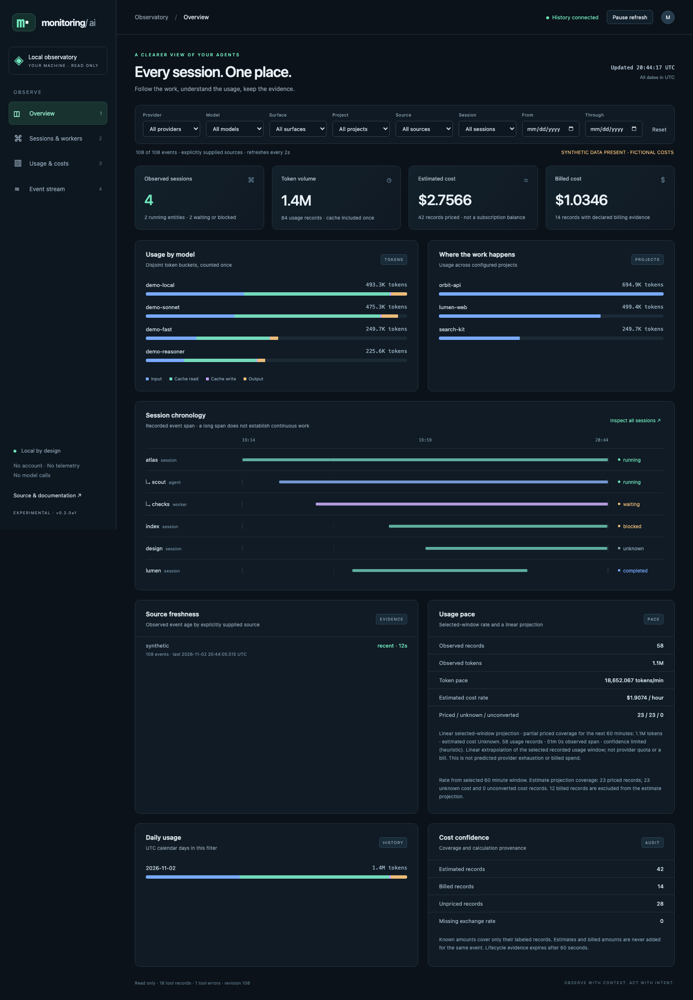

# Monitoring AI

A local observatory for AI sessions, agents, workers, tokens and costs. Use it in your terminal, open its web dashboard, or consume its read-only API from another workspace.

**Experimental alpha.** This is a working first slice, not a complete replacement for CodeBurn, ccusage, abtop or an enterprise tracing platform. It observes explicitly supplied sources. It does not discover every agent on your machine.



## Try it

Python 3.11 or later on macOS or Linux. The runtime uses only Python's standard library. No API key, model call, telemetry or account is needed.

```sh
git clone https://github.com/pradeeptathineni/monitoring-ai.git
cd monitoring-ai
python3 -m monitoring_ai serve --demo --db /tmp/monitoring-demo.sqlite
```

Open **http://127.0.0.1:5274**. The demo creates fictional events in an empty database. Choose a new database path to seed another demo. Stop with Ctrl-C. For an installed CLI, use `python3 -m pip install .`, then `monitoring-ai` in place of `python3 -m monitoring_ai`.

For an actual live demonstration, run these in separate terminals. Choose a new JSONL file and database:

```sh
python3 -m monitoring_ai demo /tmp/monitoring-live.jsonl --stream
python3 -m monitoring_ai serve --file /tmp/monitoring-live.jsonl --db /tmp/monitoring-live.sqlite
python3 -m monitoring_ai top --db /tmp/monitoring-live.sqlite --watch
```

The producer appends usage and lifecycle evidence. The server imports complete lines every two seconds. The terminal and web views read the same ledger. Stopping the producer lets its running evidence expire after 60 seconds.

## What works

- Session, agent and worker identities with parents, recorded chronology, tool outcomes and lifecycle evidence that ages independently of usage.
- Web and terminal views with provider, model, surface, project, source, session, state and UTC date filters. The web view exposes provider/model/surface/project/date and state controls.
- Token breakdowns for uncached input, cache reads, cache writes and output. Codex reasoning is already part of output and is never counted twice.
- Usage and costs grouped by model, provider, surface, project and UTC date. Estimated and billed subsets retain provenance. Unpriced and unconverted records stay explicit.
- Dated model price books and explicit currency conversion. USD is the default. No exchange rate or provider price is silently fetched.
- Atomic SQLite imports, replay deduplication, changed-identity refusal, hierarchy validation and retained observations when a followed source fails.
- A versioned read contract and a [server-side Deep AI consumer](integrations/deep-ai). Deep integration is supplied for review, not deployed by this repository.
- Source-age views, trailing-window token pace and cautious linear forecasts with observed span, sample count and explicit cost coverage.
- Independent quota observations from an explicit file or an opt-in installed Codex allowance read. Stale values and passed reset times retain their last supplied values.

## Connect your data

Prefer metadata-only [normalized events](docs/contract.md). You can import once or follow an explicitly selected append-only JSONL file:

```sh
python3 -m monitoring_ai import --file examples/events.jsonl --db /tmp/my-observatory.sqlite
python3 -m monitoring_ai top --db /tmp/my-observatory.sqlite --provider openai --json
python3 -m monitoring_ai serve --file /path/to/authorized-events.jsonl --db /tmp/my-observatory.sqlite
```

Two native file adapters are included. Only use files you own or are authorized to read. Select a complete, finalized Claude Code JSONL export or a complete Codex session JSONL file. There is no home-directory scan, credential reader, hook installation or account connection.

```sh
python3 -m monitoring_ai import --file /path/to/authorized-session.jsonl \
  --format codex --source-id my-codex-session --project my-app

python3 -m monitoring_ai import --file /path/to/authorized-session.jsonl \
  --format claude --source-id my-claude-session --project my-app
```

Use the same source ID and project alias when replaying or following a file. Different aliases create different observations and can double-count the same activity. One source must not be imported through two formats. The native adapters discard conversation content, tool arguments and filesystem paths, and hash session IDs. They reconstruct usage, **not live process state**. Missing model names stay `unknown`. A changing streamed Claude message or decreasing Codex counter refuses rather than guessing a correction. Native format coverage is fixture-tested, not verified against your personal sessions.

For pricing, adapt [the fictional price book](examples/pricing.json) to your verified rates and validity dates. All four rates are amounts per million tokens. Add `--pricing /path/to/pricing.json` to `serve` or `top`. Reported event costs take precedence. To convert, supply `--currency EUR --fx /path/to/fx.json` with a dated [FX book](examples/fx.json). Example prices and exchange rates are deliberately fictional.

## Usage pace and quotas

Overview shows recorded usage over the trailing 60-minute window. Its one-hour projection uses that full window as the denominator. The view shows sample count, observed span and a heuristic confidence label. Estimates with incomplete pricing remain qualified, and billed amounts are excluded from projected estimates. This is a linear scenario, not a prediction of provider exhaustion or a future invoice.

Quota is a separate account-wide observation. Usage filters do not make a quota project-specific. An imported snapshot can be read without any account connection:

```sh
python3 -m monitoring_ai serve --db /tmp/my-observatory.sqlite --quota-file examples/quotas.json
python3 -m monitoring_ai quota --file examples/quotas.json
```

The example is fictional and becomes stale according to its original timestamp. Demo mode seeds fresh **fictional** quota observations, with an unknown weekly value to demonstrate missing evidence. No account connection is made by default.

If the installed Codex CLI already has an authorized login, opt in to its supported account allowance interface:

```sh
python3 -m monitoring_ai quota --codex --account work
python3 -m monitoring_ai serve --db /tmp/my-observatory.sqlite --codex-quota --quota-account work
```

The first command reads once and prints quota-only JSON. The server reads at most once a minute in a separate worker, so a slow quota read does not block usage views. It sends only initialization and `account/rateLimits/read` to its own finite app-server process. It does not inspect conversations, change login, start inference, reset allowance or enable overage. `captured_at` is local response-receipt time, not a provider sample timestamp. Unsupported or unavailable sources retain prior observations with a visible failure state. Use `--codex-executable /absolute/path/to/codex` if the installed executable is not on PATH.

Quota evidence becomes stale after five minutes. Future timestamps and passed reset times are explicit. A passed reset never implies replenishment. The collector was qualified against an existing authorized Codex login, while public examples and tests remain synthetic. [The quota and insight contract](docs/contract.md#usage-insights-and-quota-observations) documents the format and limits.

## Limits

Cloud producers can write normalized metadata through an authorized export or collector. Cloud account adapters, remote authentication, OpenTelemetry receivers, hardware/process sampling, budget alerts and execution controls remain planned. Quota collection currently supports the installed Codex account interface and explicit normalized files. Subscription quotas and API-equivalent costs are different measures. This alpha does not derive one from the other.

The server binds to loopback and rejects cross-origin browser reads. It has no write API. The local ledger is private operational data, not encrypted storage. Use a private working directory with appropriate filesystem permissions. Never commit your ledger, source files or real session exports. The repository contains only fictional examples and screenshots.

Each source is limited to 32 MiB and 50,000 records per import. Snapshot reads are limited to 100,000 stored events and 500 displayed entities. File following rereads the bounded file and deduplicates it. This is suitable for a small local observatory, not a high-throughput ingestion service. The limits fail visibly instead of silently omitting usage. Latest-event drill-down is bounded to the snapshot's latest 100 events. The paged API can read older events with revision checks.

## Development

```sh
python3 -m unittest discover -s tests -v
node --test tests/client.test.mjs  # Node 24 for native TypeScript stripping
npm ci
npx playwright install chromium
npm run test:browser
```

Browser tests launch their own synthetic server and headless browser. They make no model call and do not use your foreground browser. See [the contract](docs/contract.md), [reuse findings](docs/reuse.md) and [roadmap](docs/roadmap.md). MIT licensed.
