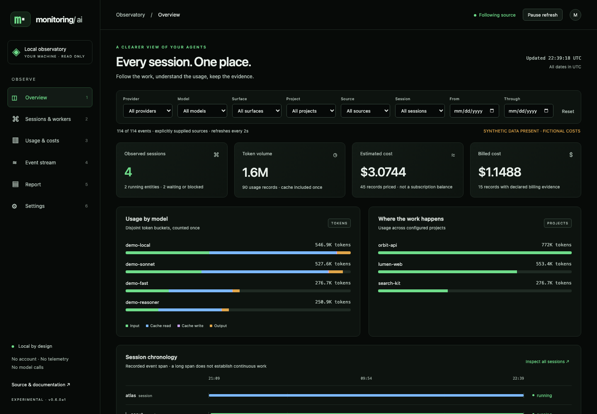
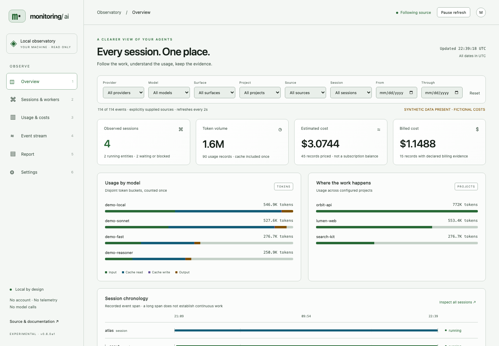
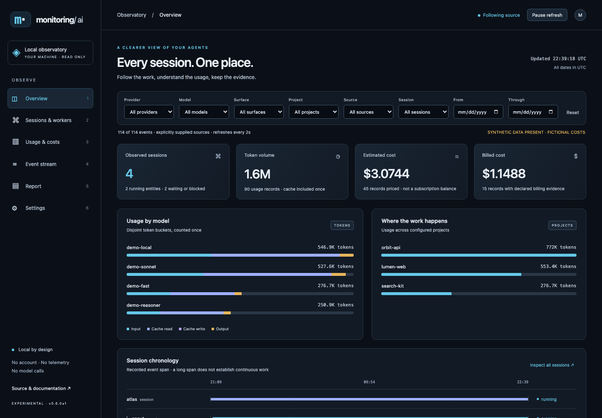
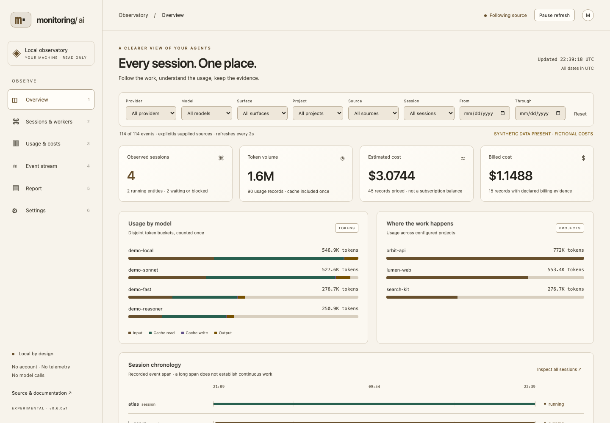
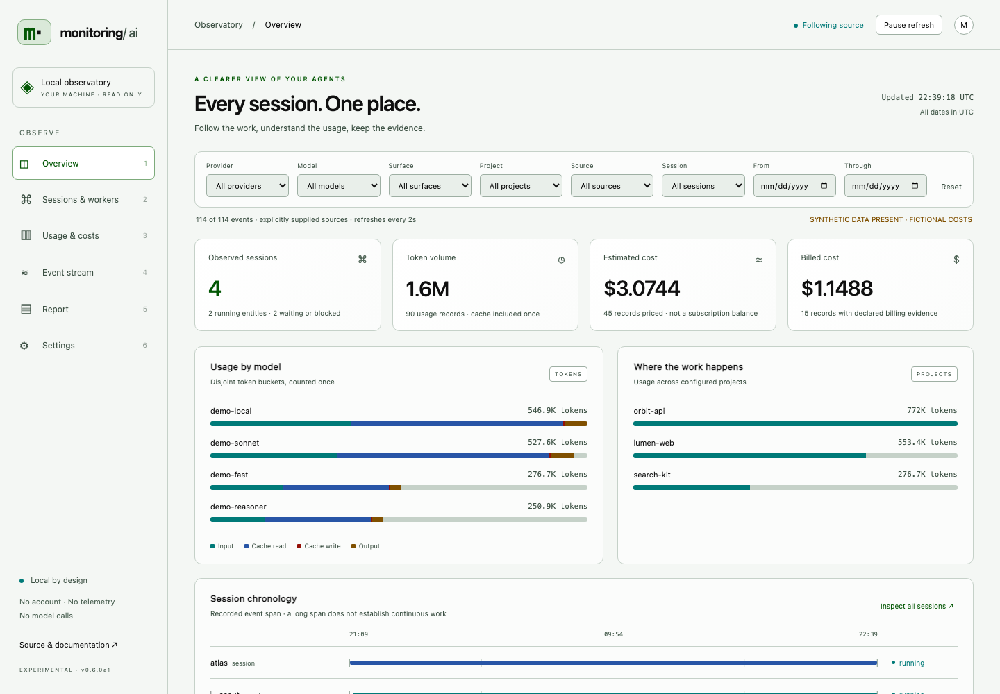
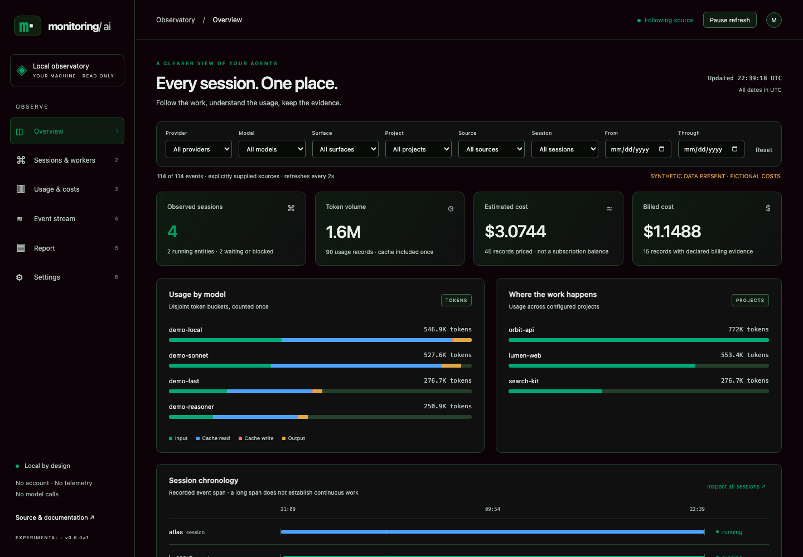

# Dashboard theme gallery

All six images use the same fictional data and Overview layout. Appearance and source configuration live in Settings. No Deep screens, personal usage or account observations are included.

## Neon 1 Dark

## Neon 1 Light

## Slate Dark

## Sand Light

## Forest Light

## Matrix Dark

## Settings and mobile

[Settings desktop](settings.png) · [Settings phone](settings-mobile.png) · [Overview phone](overview-mobile.png) · [Coverage phone](coverage-mobile.png)

[Verification receipt](gallery.json) records rendered scheme, semantic colors and body contrast. Checks cover intended presets, hidden Overview configuration, no page errors and mobile overflow. This is representative synthetic rendering, not complete accessibility or live-provider qualification.

Reproduce with Node 24 and the development dependencies installed: `node tools/capture-gallery.mjs`. It starts and stops its own temporary synthetic loopback server and uses an independent headless browser. No account or network source is contacted.
