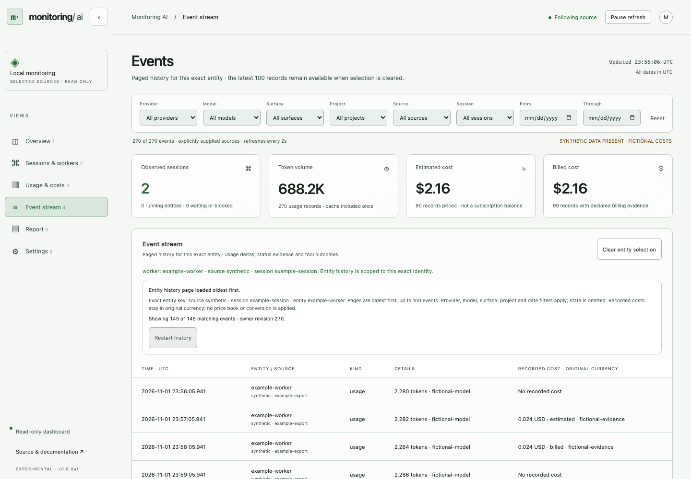

# Entity history



[Phone view](entity-history-mobile.png) · [Synthetic verification receipt](entity-history.json). Reproduce with Node 24 and the development dependencies installed: `node tools/capture-history.mjs`. The script starts and stops a temporary fictional source and local server. Its 145 selected records are absent from the latest 100 snapshot records and load in two history pages. No personal session, account connection or model request is involved.

Open **Sessions, agents and workers**, then select an entity. The Events view reads its history in chronological pages of 100. The source, session and entity together identify the selection. Two workers with the same name in different sessions remain separate.

For the same exact selection from an existing ledger without a server, use the [terminal history command](terminal-history.md). It has its own local JSON page schema and cannot claim a running owner's identity.

Current provider, model, surface, project and UTC date filters still apply. Current-state filtering selects entities in Sessions but does not hide earlier status events in their history. Clear the entity selection to return to the latest 100 matching snapshot events.

Use **Load more events** for the next page. Loaded pages belong to one ledger revision. A new event can change chronological offsets, so a ledger change requires **Restart history** before reading another page. A restarted owner also requires a deliberate restart against its new snapshot identity. Previously loaded records remain historical observations. Refreshing a snapshot does not silently replace them.

A page may have usage with no known price. Its event cost displays only supplied estimated or billed evidence, in the supplied currency. This history route does not apply the dashboard price book or combine amounts into a total. Use Usage and costs or the Usage report for qualified aggregate pricing and explicit conversion.

Source reads, usage timestamps and lifecycle evidence have separate meanings. Reading history does not advance an event timestamp, refresh a worker status or prove that the process still exists. A paused or unavailable dashboard retains metadata and marks nonterminal states unknown. Terminal statuses remain recorded outcomes, rather than proof of task acceptance.

## Read contract

```text
GET /api/v1/events?source=example&session=example-session&entity=example-worker&limit=100
GET /api/v1/events?source=example&session=example-session&entity=example-worker&limit=100&after=100&expected_revision=123
```

The first response supplies `identity`, `revision`, `total`, `events` and `next_offset`. Pin the process identity and pass that first revision on later pages. HTTP 409 requires a fresh read from offset zero. Stop at a null `next_offset`. The route accepts at most 500 events per page and reads the same bounded metadata ledger as snapshots. Unknown or repeated query fields refuse.

The optional `entity` filter requires both `source` and `session`. It is specific to event pages and is advertised under capabilities `event_filters`. Existing snapshot/report filters and schemas remain unchanged. See the [owner contract](contract.md) and [Deep handoff](../integrations/deep-ai).
